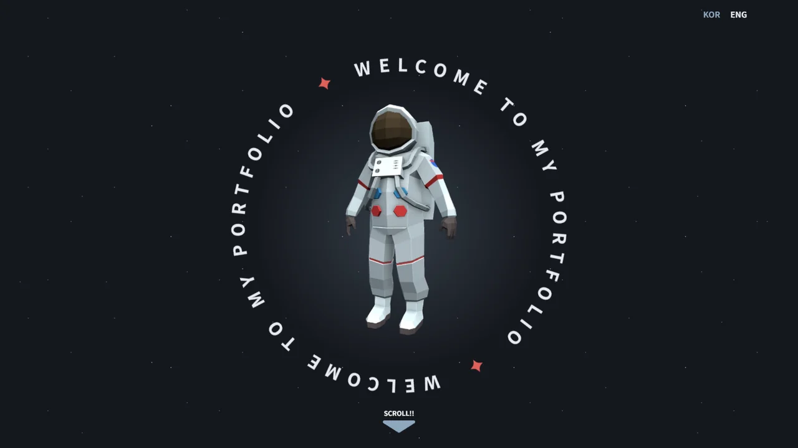

# 이재영 | 프론트엔드 개발자 포트폴리오

스크롤을 내리면 가운데 캐릭터가 360° 회전하고, 그 양옆으로 저의 기술 스택·경력·교육 이력과 프로젝트가 올라오는 포트폴리오 웹사이트입니다.
HTML, CSS, JavaScript만으로 직접 디자인하고 개발했습니다.

**🔗 사이트 보기: https://yisang0527.dothome.co.kr/**



## 주요 기능

- **스크롤 회전 캐릭터**: 3D 우주비행사 모델을 72장(5° 간격)으로 렌더링하고, 스크롤 진행률에 맞춰 `<canvas>`에 그려 360° 회전
- **고정 캐릭터 + 흐르는 콘텐츠**: 캐릭터만 `position: sticky`로 화면 가운데에 고정하고, 좌우 콘텐츠 카드는 자연스럽게 위로 스크롤
- **첫 화면 연출**: 캐릭터 주위를 도는 원형 `WELCOME TO MY PORTFOLIO` 문구(SVG `textPath`)와 스크롤 안내
- **한국어 / 영어 전환**: `data-lang` 속성과 번역 사전으로 문구 전체를 전환하고, 선택한 언어를 `localStorage`에 저장
- **반응형**: 데스크톱은 `[콘텐츠 | 캐릭터 | 콘텐츠]` 3단, 모바일은 캐릭터를 배경처럼 두고 카드가 그 위로 지나가는 1단 구성
- **접근성 고려**: 시맨틱 마크업, 키보드 포커스 표시, `prefers-reduced-motion`(움직임 줄이기) 설정 시 애니메이션 최소화
- **그 밖의 UI**: 스크롤 진행률 바, 맨 위로 버튼, 기술 스택 브랜드 아이콘

## 기술 스택

| 구분 | 사용 기술 |
|---|---|
| Markup | HTML5 (시맨틱 태그, 인라인 SVG) |
| Style | CSS3 (Native Nesting, Grid, Sticky, CSS 변수, Mask) |
| Script | Vanilla JavaScript (Canvas API, `requestAnimationFrame`) |

별도의 빌드 도구나 라이브러리 없이 동작합니다.

## 폴더 구조

```
portfolio/
├── index.html
├── css/
│   ├── base.css        # 리셋 + 색상 변수(차콜 블랙 팔레트)
│   ├── common.css      # 레이아웃 · 컴포넌트 · 반응형
│   └── icons.css       # 기술 스택 아이콘 (SVG data URI)
├── js/
│   ├── main.js         # 진행률 바, 첫 화면 요소, 맨 위로 버튼, 언어 전환
│   └── character.js    # 스크롤에 따른 캐릭터 360° 회전
└── images/
    ├── character/      # 캐릭터 프레임 이미지 (frame_001.webp ~ frame_072.webp)
    ├── icons/          # 기술 스택 아이콘 원본 SVG
    └── projects/       # 프로젝트 캡처 이미지
```

## 실행 방법

배포된 사이트: https://yisang0527.dothome.co.kr/

로컬에서 확인할 때는 빌드 과정 없이 `index.html`을 브라우저로 열면 됩니다.
VS Code의 Live Server 같은 로컬 서버로 열어도 됩니다.

## 크레딧

- 기술 스택 아이콘: [Simple Icons](https://simpleicons.org) (CC0)

## 연락처

- Email: yisang0527@gmail.com
- GitHub: https://github.com/yisang0527
